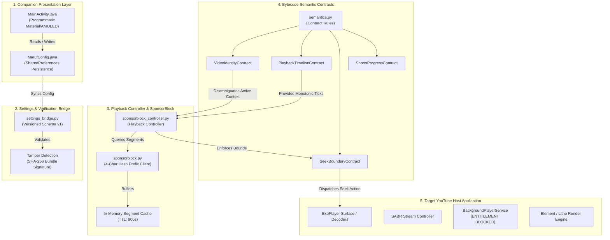

# MarufYT Android — System Architecture (Phase 3)

**Author:** Senior Software Architect  
**Project:** MarufYT Android (`arifular1f/MarufYT-Android`)  
**Target Platform:** Android 8.0+ (API 26 to API 36) · Rootless Operation  

---

## 1. Architectural Overview

MarufYT Android is architected as a modular, decoupled framework comprising five core operational domains:
1. **Companion Dashboard Layer:** Native Android UI (`app/`) for user preference management.
2. **Settings Bridge Layer:** Cryptographically verifiable schema bridging companion preferences with runtime bytecode injection points.
3. **Playback & SponsorBlock Engine:** State-machine playback controller managing timeline ticks, segment evaluation, and debounced seek execution.
4. **Smali & Bytecode Semantic Contracts:** Mathematical and type contracts specifying exact preconditions and invariants for Smali patch hooks.
5. **Static Forensic & Fingerprinting Engine:** Automated static analysis tools verifying DEX bytecodes and resource symbol tables across YouTube releases.

---

## 2. Core Subsystems

### 2.1 Settings-to-Runtime Bridge
To guarantee that companion UI selections safely map to runtime behavior, the bridge enforces:
- **Versioned Schema (`CONFIG_VERSION = 1`):** Every configuration payload specifies its schema revision. Backward compatibility migrations are handled explicitly.
- **Strict Invariants:** Telemetry is structurally immutable (`telemetry_allowed == False`).
- **Cryptographic Export/Import:** Configuration states can be exported as portable JSON bundles signed with SHA-256 digests.

### 2.2 SponsorBlock Playback State Machine
The `SponsorBlockPlaybackController` governs playback event sequencing:
1. **Context Disambiguation:** Video start events verify `context == "active_playback"`. Preloads and feed previews are filtered out.
2. **Hash-Prefix Lookup:** Queries are dispatched using 4-character SHA-256 hash prefixes to preserve viewer anonymity.
3. **Continuous Evaluation:** When timeline ticks arrive ($250\text{ ms}$ cadence), current timestamp $t_{\text{current}}$ is tested against enabled segment bounds $[t_{\text{start}}, t_{\text{end}})$.
4. **Debounced Dispatch:** Seek requests are throttled with a $250\text{ ms}$ debounce window and filtered against a skipped UUID set to prevent re-entrant loops.

### 2.3 Semantic Contracts for Smali Hooking
Smali patches cannot rely on fragile obfuscated method names across YouTube versions. The semantic contract system decouples hook specifications into verified behaviors:
- `VideoIdentityContract`: Validates 11-character Base64URL identifiers and context flags.
- `PlaybackTimelineContract`: Normalizes microsecond clocks, handles `TIME_UNSET` sentinels, and converts rational ticks.
- `SeekBoundaryContract`: Enforces seek parameter bounds within $[0, \text{duration}]$, preventing media pipeline crashes.
- `ShortsProgressContract`: Validates vertical video progress metrics and normalizes display ratios.

---

## 3. Boundary Classifications & Hard Blockers

| Feature Domain | Architectural Integration Point | Classification | Technical Justification |
| :--- | :--- | :--- | :--- |
| **SponsorBlock Auto-Skip** | `PlaybackController` / `SeekBoundaryContract` | **PASS (Ready)** | Decoupled controller with debouncing and hash lookups. |
| **Appearance & Theming** | Native Companion `MainActivity` / `MarufConfig` | **PASS (Complete)** | Full 15-domain settings dashboard with AMOLED black. |
| **Player Gestures** | Touch listener overlay on ExoPlayer View | **PASS (Ready)** | Direct swipe translation to system brightness/audio streams. |
| **Background Playback** | `BackgroundPlayerService.onStartCommand` | **BLOCKED** | Host enforces `Lasll;->d(Service)V` Premium entitlement checks. |
| **Downloads / Offline** | Media cache manager / DRM pipeline | **BLOCKED** | Hardcoded Widevine DRM encryption prohibits stream dumping. |
| **Home & Feed Filter** | Browse tab Protobuf Litho renderer | **BLOCKED** | Elements framework lacks clean hookable adapter views. |

---

## 4. Source-Only Deployment Model

The MarufYT repository strictly distributes **source code, analysis tools, and companion assets**. No proprietary Google or YouTube APKs, binaries, or signing keys are tracked or published.
