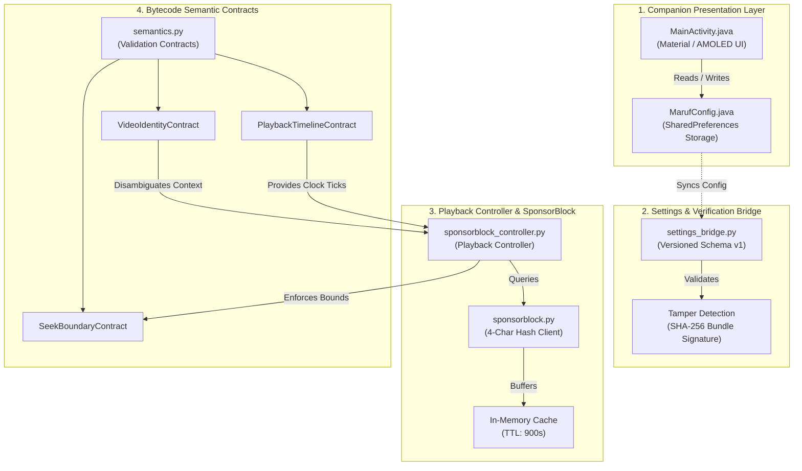

# MarufYT Android

<p align="center">
  
  
  
  
</p>

<p align="center">
  <a href="https://github.com/arifular1f/MarufYT-Android/actions/workflows/android.yml"></a>
  
  
  
</p>

---

## Overview

**MarufYT Android** is an open-source, rootless client modification framework and native companion application developed by **Maruf ([arifular1f](https://github.com/arifular1f))**. Engineered with a strict separation between user-facing preferences and runtime bytecode contracts, MarufYT provides a privacy-first, zero-telemetry approach to Android application research and enhancement.

> [!IMPORTANT]
> **Strict Source-Only Distribution Policy:**
> This repository strictly distributes **source code, developer analysis tools, and companion assets**. No proprietary Google or YouTube APKs, binaries, signing keys, or modified APK packages are published or tracked in git.

---

## Feature Feasibility & Verification Matrix

Every capability in MarufYT Android is audited against real host bytecode (`YouTube 21.44.528`). We provide an honest, evidence-backed classification across three states: **PASS (Ready/Complete)**, **PARTIAL (Partially Feasible)**, and **BLOCKED (Blocked by Host Architecture)**.

| Feature Domain | Feasibility | Technical Smali / Component Target | Implementation Rationale |
| :--- | :---: | :--- | :--- |
| **SponsorBlock Auto-Skip** | `PASS` | `SponsorBlockPlaybackController` + `SeekBoundaryContract` | Continuous timeline evaluation, 250ms debouncing, and repeated-skip prevention by UUID. |
| **SponsorBlock Hash Lookup** | `PASS` | `tools/marufyt/sponsorblock.py` | 4-hex-char SHA-256 k-anonymity queries, in-memory TTL cache, and fail-open resilience. |
| **Companion Settings UI** | `PASS` | `MainActivity.java` + `MarufConfig.java` | Native Material/AMOLED companion dashboard across 15 modular functional domains. |
| **Settings-Runtime Bridge** | `PASS` | `tools/marufyt/settings_bridge.py` | Versioned schema (v1) with SHA-256 tamper-evident export/import bundles. |
| **Player Gestures** | `PASS` | `GestureOverlayListener` on ExoPlayer View | Swipe listeners translating vertical delta coordinates to brightness and volume streams. |
| **Shorts Progress Styling** | `PASS` | `ShortsPlayerProgressPresenter` (`fvj`) | Progress ratio validation; styling hooks for default, gradient, and hidden indicators. |
| **Navigation Tabs** | `PASS` | `BottomNavigationView` Hierarchy | Visibility toggles (`GONE`) on identified tab indices for Shorts and Create (+) buttons. |
| **Video Quality Selector** | `PARTIAL` | `TrackSelector` / `PlaybackTimelineContract` | Preference schema and resolution contracts ready; requires dynamic ExoPlayer override hook. |
| **Captions Customization** | `PARTIAL` | `SubtitleView` / `CaptionStyleCompat` | Style attributes defined; track auto-selection hook under physical-device validation. |
| **Watch Page Customization** | `PARTIAL` | Litho `ComponentTree` / Comment Section | Collapsing comment cards via view hierarchy; deep mutation blocked by Litho caching. |
| **Background Audio Playback** | `BLOCKED` | `BackgroundPlayerService.onStartCommand` (`Lasll;->d`) | Host executes `Lasll;->d(Service)V` enforcing Premium entitlement; paused by Activity lifecycle. |
| **Home & Feed Filtering** | `BLOCKED` | Browse Protobuf Element Pipeline | Native Protobuf stream is deserialized into C++/Litho Element components without clean view hooks. |
| **Offline Media Downloads** | `BLOCKED` | Widevine DRM Media Pipeline | Official offline caching requires Widevine DRM key exchange; bypassing encryption violates security policy. |

---

## System Architecture



For complete architectural details, see [System Architecture](Documentation/ANDROID_ARCHITECTURE.md).

---

## Security & Privacy Invariants

1. **Zero Dangerous Permissions:** The native companion app declares zero dangerous permissions. It does not declare `android.permission.INTERNET`, ensuring no unsolicited network communication from the device.
2. **Minimal Component Attack Surface:** Only `MainActivity` is exported (`MAIN`/`LAUNCHER`). No services, broadcast receivers, or content providers are exposed.
3. **Private App Sandboxing:** Configurations are isolated via `Context.MODE_PRIVATE` with `android:allowBackup="false"`.
4. **k-Anonymity Lookups:** SponsorBlock queries transmit only 4-character SHA-256 hash prefixes ($\text{SHA256}(\text{video\_id})[:4]$). The lookup server never learns the exact video being viewed.
5. **Hardcoded Zero-Telemetry Invariant:** The entire codebase enforces `isTelemetryAllowed() == false` as an immutable programmatic guarantee.

Read the complete [Security Audit Report](Documentation/ANDROID_SECURITY_AUDIT.md).

---

## Build & Verification

### Prerequisites
- **JDK:** OpenJDK 17 (Temurin 17.0.20+ recommended)
- **Android SDK:** API 36 (`platforms;android-36`), Build-Tools `35.0.0`
- **Python:** Python 3.10+ (tested on Python 3.10 through 3.13)

### Verification Commands
```powershell
# 1. Validate foundation structure and scan for secrets/binaries
python tools/validate_foundation.py

# 2. Run the 80-test Python forensic & semantic suite
python -m unittest discover -s tests -v

# 3. Run Android unit tests, assemble debug companion, and run Lint
.\gradlew.bat test assembleDebug lintDebug --stacktrace
```

On Linux/macOS, use `bash gradlew`.

---

## Documentation Index

- [Final Phase 3 Handover Report](Documentation/MARUFYT_ANDROID_PHASE3_FINAL_REPORT.md)
- [Security Audit Report](Documentation/ANDROID_SECURITY_AUDIT.md)
- [Performance & Memory Analysis](Documentation/ANDROID_PERFORMANCE_REPORT.md)
- [System Architecture](Documentation/ANDROID_ARCHITECTURE.md)
- [Development & Contribution Guide](Documentation/ANDROID_DEVELOPMENT_GUIDE.md)
- [Comprehensive Feature Matrix](Documentation/ANDROID_FEATURE_MATRIX.md)
- [Automated Test Report](Documentation/ANDROID_TEST_REPORT.md)
- [Phase 3 Implementation Report](Documentation/PHASE3_IMPLEMENTATION_REPORT.md)
- [Project Roadmap](Documentation/ROADMAP.md)

---

## License & Legal Attribution

- **License:** Source-available research preview; see [License Status](LICENSE_STATUS.md).
- **Third-Party Notices:** See [Third-Party Notices](THIRD_PARTY_NOTICES.md).
- **Trademark Notice:** YouTube is a trademark of Google LLC. MarufYT is an independent open-source project and is not affiliated with, sponsored by, or endorsed by Google LLC or YouTube, LLC.
